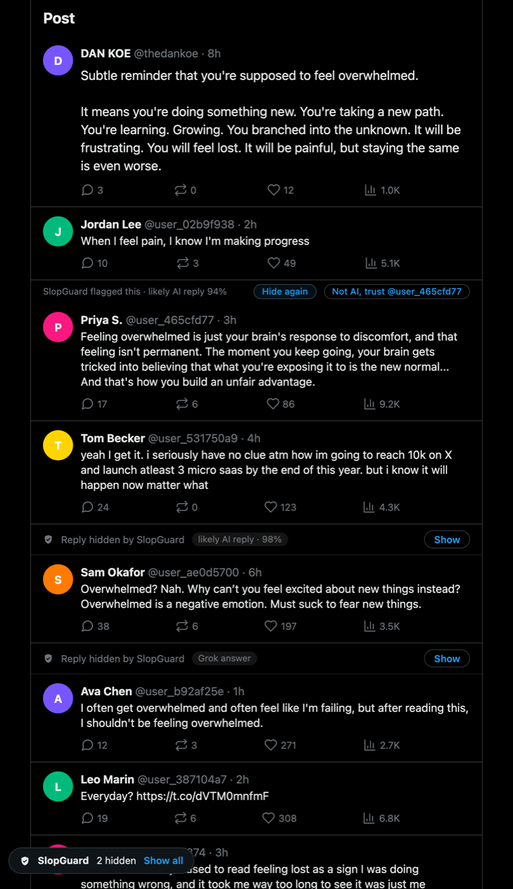
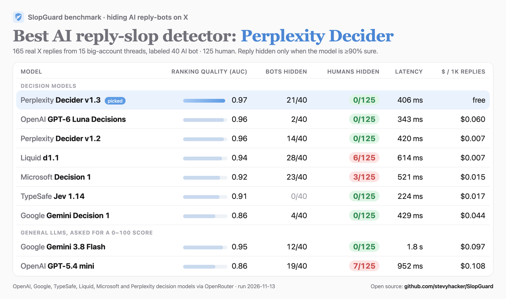

<p align="center">
  
</p>

<h1 align="center">SlopGuard</h1>

<p align="center">
  Folds away AI-bot replies under posts on X, so the thread is just people again.<br>
  One click brings any reply back.
</p>

<p align="center">
  <a href="#install">Install</a> ·
  <a href="#how-it-works">How it works</a> ·
  <a href="#benchmark">Benchmark</a> ·
  <a href="#privacy">Privacy</a>
</p>

<p align="center">
  
</p>

## What it hides

The replies that restate the post back to its author, praise it in generic terms, add nothing new and read like an assistant wrote them:

> "Great insight! This highlights how important consistency is. Growth happens outside the comfort zone 🚀"

Real people stay, even when they are short, rude, joking or wrong.

- **Only when it's sure.** A reply is folded when the model is at least 90% confident. On our test set that hid about half the bots and zero real people.
- **Seamless.** A folded reply becomes a one-line bar. Click it to read the reply, click **Hide again** to fold it back, or **Not AI** to always trust that account.
- **Cheap and fast.** Replies are scored in batches by a decision model, a model that returns a probability instead of text. The default is free on OpenRouter and answers in about 0.4 s.
- **Your rules.** Change the threshold, limit it to replies under your own posts, fold or keep `@grok` answers, and pick another model.

## Install

**Chrome Web Store:** coming soon.

**From source**

1. Download this repo (`git clone https://github.com/stevyhacker/SlopGuard` or **Code → Download ZIP**).
2. Open `chrome://extensions`, turn on **Developer mode**, click **Load unpacked** and pick the folder.
3. In the settings page that opens, paste an [OpenRouter API key](https://openrouter.ai/settings/keys), click **Save**, then **Test connection**.
4. Open any post on X.

It works on a post's own page (`x.com/<user>/status/<id>`). Replies are checked as X loads them while you scroll, and fold about a second later. A small pill in the corner shows how many were hidden.

## How it works

1. The content script reads the post and the replies X has rendered.
2. New replies go to the model in batches of up to 10, together with the post, through [OpenRouter's Decisions API](https://openrouter.ai/docs/api/api-reference/alphadecisions/submit-a-decisions-request).
3. Each reply gets two yes/no questions: *was this written by an AI reply bot?* and *does it have an AI-assistant or ghostwriter tone?* The score is the higher of the two. See [`src/classifier.js`](src/classifier.js).
4. Replies scoring at or above the threshold (90% by default) are folded.

Skipped without an API call: the post author's own replies, your replies, accounts you trusted, and replies under 16 characters. Verdicts are cached for 14 days, so a reply is never scored twice.

## Benchmark

<p align="center">
  
</p>

We pulled 15 recent threads from large tech, AI, crypto and creator accounts and labeled 165 replies: **40 AI bot, 125 human**. Every model got the same request the extension sends. The prompt was tuned on 8 threads and checked on the other 7.

- **Perplexity Decider v1.3 (default)** ranked replies best (AUC 0.97 on both halves) and was the only model that often reached 90% confidence. It hid 21 of 40 bots and none of the 125 humans. It's free on OpenRouter, and when the free tier is rate limited the extension falls back to the paid v1.2.
- **OpenAI GPT-6 Luna Decisions** ranks almost as well (0.96) but rarely goes above 90%, so it hid only 2 bots.
- **TypeSafe Jev** is the fastest (about 220 ms) and ranks well (0.91), but never exceeds 90% on this task. Use it with the threshold around 60%.
- **Liquid d1.1, Microsoft Decision 1 and GPT-5.4 mini** catch more bots, but also hide real people (3 to 7 of 125).

All 14 models, per-reply scores and the dataset are in [`bench/`](bench). The labels are one person's judgment on a small set, so treat the numbers as a guide. Re-run it with your own keys:

```bash
cp .env.example .env          # add OPENROUTER_API_KEY (and OPENAI / GEMINI keys for the LLM rows)
node bench/run.mjs            # every model
node bench/run.mjs pplx jev   # only matching models
```

## Privacy

- Your API key stays in the extension's local storage and is sent only to the provider you choose.
- For each batch, the provider receives the post's text and author handle and each reply's text and handle. Nothing else from X is sent: no account info, cookies, DMs or browsing history.
- There is no SlopGuard server. Nothing is collected or sent to us.

## Development

```bash
npm install          # Playwright, for the end-to-end test only
npm test             # unit tests, mocked network
npm run check        # syntax and manifest
npm run test:e2e     # loads the extension in Chromium on an X-like thread and calls the real model
```

Plain JavaScript, Manifest V3, no build step. `src/classifier.js` is shared by the extension and the benchmark, so the benchmark measures exactly what ships.

## Limitations

- X changes its markup often. SlopGuard relies on `data-testid="tweet"`, `tweetText` and the status links in each post.
- Only post pages are filtered, not the home timeline.
- Text only: images, videos and quoted posts are not judged.

## Credits

Inspired by [x-reply-filter](https://github.com/zhuyansen/x-reply-filter) and [x-reply-judge-jev](https://github.com/liaocaoxuezhe/x-reply-judge-jev). MIT License.
